# AI-Based Campus Energy Consumption & Anomaly Detection System
### Coimbatore Institute of Technology (CIT), Coimbatore

An academic research prototype and decision support system for campus building energy modeling, expected baseline regression, dual-method anomaly detection, and operational workflow management.

---

## 🏛️ Project Overview

Colleges and university campuses represent complex micro-grids with heterogeneous operational demands spanning lecture theatres, research laboratories, computer clusters, administrative blocks, and workshops. This project provides CIT Coimbatore with an intelligent, data-driven energy decision support system that:

1. **Models Expected Campus Baselines:** Trains traditional ensemble machine learning (`RandomForestRegressor`, $R^2 = 0.9720$) on building physical attributes, seasonal climate, and occupancy context.
2. **Surfaces Anomaly Events via Dual Methods:** Combines percentage residual deviation analysis ($\Delta\text{ kWh} > 40\%$) with multi-dimensional unsupervised outlier detection (`IsolationForest`, $c = 0.03$).
3. **Explains Root Causes Deterministically:** Evaluates physical rules to produce transparent hypotheses and physical verification checklists without AI hallucinations.
4. **Prescribes Actionable Directives:** Assigns specific operational steps to campus personnel (*Electrical Supervisor*, *HVAC Technician*, *Estate Officer*) with quantified financial savings at ₹7.50/kWh.
5. **Benchmarks Against Deep Learning:** Implements a sequence-based Long Short-Term Memory (`CITLSTMRegressor`, $R^2 = 0.9304$) in pure NumPy/Scikit-learn over a 24-hour diurnal sliding window.
6. **Delivers Interactive 2D Dashboards:** Provides interactive telemetry plots, 24-hour diurnal load curves, building registry management, and forensic dossiers via React 19, TypeScript, Tailwind CSS, and Recharts.

---

## 🏗️ System Architecture

```mermaid
flowchart TD
    subgraph Frontend ["React 19 + TypeScript + Vite + Tailwind CSS (Port 5173)"]
        Nav["Navigation Header & Live Backend Status"]
        Overview["Overview Dashboard (Recharts Telemetry & Diurnal)"]
        Registry["CIT Building Registry (CRUD & Deactivation)"]
        DataEntry["Manual Energy Entry (Instant ML Inference)"]
        AnomalyCenter["Anomaly Center (Forensic Investigation Dossier)"]
        RecsView["Operational Recommendations (Savings & Roles)"]
        ModelDiag["Model Performance (RF vs LSTM Comparative Benchmark)"]
        SettingsView["System Settings (Threshold Calibration)"]
    end

    subgraph Backend ["FastAPI REST Service (Python 3.14 - Port 8000)"]
        API_Buildings["/api/buildings"]
        API_Readings["/api/readings (Manual + CSV I/O)"]
        API_Predict["/api/predictions (RF Inference)"]
        API_Anomalies["/api/anomalies (Dual-Method & Batch Scan)"]
        API_Recs["/api/recommendations"]
        API_Dash["/api/dashboard (KPIs & 24h Timeseries)"]
        API_Models["/api/models (RF vs LSTM Comparison)"]
        API_Settings["/api/settings"]
    end

    subgraph ML ["Machine Learning & Preprocessing Layer"]
        Prep["Preprocessor (Cyclical Sin/Cos, Missingness Booleans)"]
        RF["RandomForestRegressor v1.0 (R² = 0.9720)"]
        IsoForest["IsolationForest v1.0 (Outlier Intensity)"]
        LSTM["CITLSTMRegressor v1.0 (24h Sliding Window BPTT)"]
        Rules["Deterministic Physical Explainability Engine"]
    end

    subgraph Database ["Persistence Layer"]
        DB[(PostgreSQL / Transparent SQLite Fallback cit_energy.db)]
        Alembic["Alembic Schema Version Migrations"]
    end

    Frontend -->|REST JSON| Backend
    Backend --> ML
    Backend --> Database
    ML --> Database
```



---

## ⚡ Quick Start Guide

### Prerequisites
- Linux OS (Arch Linux, Ubuntu/Debian, or Fedora)
- Python 3.11+ (Python 3.14 compatible)
- Node.js 18+ and npm

### 1. Clone & Set Up Backend
```bash
# Navigate to backend directory
cd "backend"

# Activate the virtual environment
source venv/bin/activate

# Install dependencies (if setting up fresh)
pip install -r requirements.txt

# Run database migrations
alembic upgrade head

# Start FastAPI backend server
uvicorn app.main:app --host 127.0.0.1 --port 8000 --reload
```
*Backend Swagger API Documentation:* `http://127.0.0.1:8000/docs`

### 2. Set Up Frontend
```bash
# In a separate terminal, navigate to frontend directory
cd "frontend"

# Install npm dependencies
npm install

# Start Vite development server
npm run dev
```
*Frontend Application:* `http://localhost:5173`

---

## 🧪 Running the Test Suite

The system includes a comprehensive pytest suite covering all 11 entities, data validation, preprocessing, Random Forest inference, Isolation Forest outlier detection, explanation rules, and REST endpoints:

```bash
# From the project root
./backend/venv/bin/pytest -v
```

Expected output:
```
======================= 49 passed, 5 warnings in 11.26s ========================
```

To verify frontend TypeScript compilation and production packaging:
```bash
npm --prefix frontend run build
```

---

## 📊 Model Performance Summary

Evaluated on unseen chronologically held-out test split ($N = 1,152$ observations):

| Metric | Random Forest (v1.0) | LSTM Sequence Model (v1.0) | Selected Role |
| :--- | :---: | :---: | :--- |
| **$R^2$ Score** | **0.9720** | **0.9304** | **Random Forest (+4.16% variance)** |
| **MAE (kWh)** | $2.25\text{ kWh}$ | $0.17\text{ kWh}$ | LSTM (Lagged sequence advantage) |
| **RMSE (kWh)** | $3.82\text{ kWh}$ | $0.27\text{ kWh}$ | LSTM (Extreme deviation penalty) |
| **Train Time (s)** | **1.45 s** | **9.54 s** | **Random Forest (6.5x faster)** |
| **Inference Latency** | **0.08 ms** | **0.04 ms** | **Both sub-millisecond** |
| **Input Buffer** | **1 row (Instant)** | 24 prior consecutive hours | **Random Forest (Essential for manual data entry)** |
| **Interpretability** | **High (Gini Impurity)** | Low (Black-box recurrent gates) | **Random Forest (Audit-ready for engineers)** |

---

## 📁 Repository Structure

```
├── backend/
│   ├── alembic/                    # Database migration scripts
│   ├── app/
│   │   ├── api/                    # FastAPI route controllers
│   │   ├── core/                   # Pydantic BaseSettings & SQLAlchemy session
│   │   ├── models/                 # 11 normalized SQLAlchemy database models
│   │   ├── schemas/                # Pydantic request/response schemas
│   │   └── services/               # Core business logic & analytics services
│   ├── ml/
│   │   ├── data/                   # Synthetic generator & EDA diagnostics
│   │   ├── saved_models/           # Serialized joblib model artifacts
│   │   ├── lstm_model.py           # Pure NumPy LSTM with BPTT & Adam
│   │   ├── preprocessing.py        # Cyclical sin/cos encodings & splitters
│   │   ├── train_rf.py             # Random Forest training pipeline
│   │   ├── train_isolation_forest.py # Isolation Forest pipeline
│   │   └── train_lstm.py           # LSTM sequence training pipeline
│   ├── tests/                      # 49 unit and integration pytest modules
│   └── cit_energy.db               # Local SQLite database fallback
│
├── frontend/
│   ├── src/
│   │   ├── components/             # Navbar and reusable UI components
│   │   ├── pages/                  # Overview, Buildings, EnergyData, AnomalyCenter,
│   │   │                           # Recommendations, ModelPerformance, Settings
│   │   ├── services/               # Centralized fetch API client (api.ts)
│   │   └── types/                  # Strict TypeScript interfaces
│   └── package.json
│
└── docs/
    ├── ACADEMIC_REPORT.md          # Comprehensive formal academic project report
    ├── VIVA_PREPARATION_GUIDE.md   # Exhaustive viva voce Q&A defense guide
    └── DEMO_RUNBOOK.md             # 9-step examiner presentation script
```

---

## 📚 Academic Documentation

- [Detailed Academic Project Report](docs/ACADEMIC_REPORT.md)
- [Comprehensive Viva Voce Examination Guide](docs/VIVA_PREPARATION_GUIDE.md)
- [Step-by-Step Viva Demonstration Script](docs/DEMO_RUNBOOK.md)

---

## 📜 Academic Attribution & License

Developed as an academic research prototype for **Coimbatore Institute of Technology (CIT), Coimbatore**.  
Designed for educational demonstration, viva voce evaluation, and institutional decision support research.

