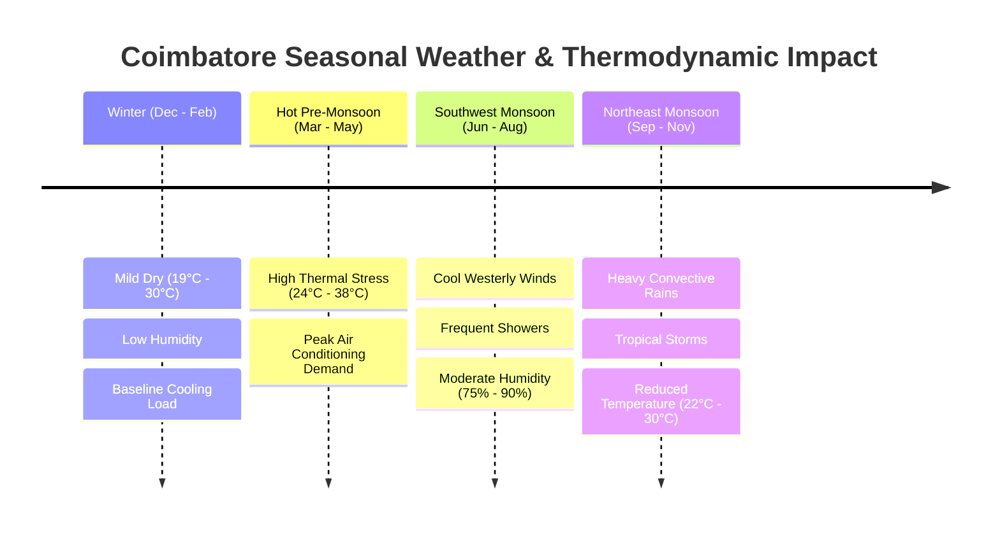
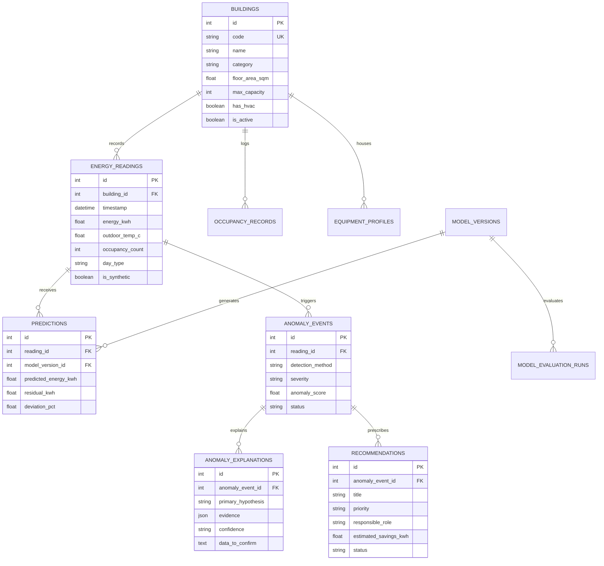
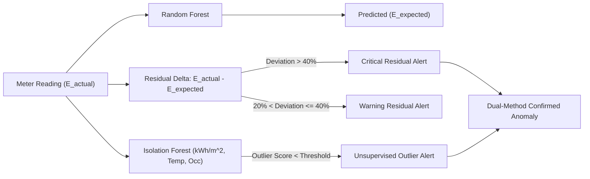

# Academic Project Report: AI-Based Campus Energy Consumption and Anomaly Detection System

**Institution:** Coimbatore Institute of Technology (CIT), Coimbatore  
**Project Category:** Machine Learning, Time-Series Analytics & Full-Stack Decision Support Prototype  
**Academic Year:** 2026–2027  

---

## 1. Executive Summary & Problem Formulation

Institutions of higher education are complex micro-communities characterized by diverse facilities—lecture halls, high-performance computing centers, heavy machinery workshops, research laboratories, administrative offices, and residential hostels. At Coimbatore Institute of Technology (CIT), Coimbatore, electrical consumption is subject to distinct diurnal, weekly, academic, and meteorological rhythms.

Traditional campus energy monitoring relies on periodic, manual meter aggregation and retrospective utility billing analysis. This reactive approach suffers from four fundamental drawbacks:
1. **Delayed Fault Identification:** Water pump overflows, air conditioning units left running overnight, or transformer phase imbalances are often discovered only when monthly utility bills arrive.
2. **Absence of Contextual Baselines:** Comparing raw electricity usage between buildings without accounting for floor area ($m^2$), occupant headcount, ambient temperature, humidity, and calendar schedules yields misleading conclusions.
3. **Black-Box Alert Fatigue:** Unsupervised statistical thresholds flag numerical deviations without explaining the physical root cause, overwhelming facilities staff.
4. **Lack of Actionable Operational Workflows:** Standard building dashboards present raw kilowatt-hour plots but fail to prescribe specific mitigation steps or assign responsibility to campus roles.

To address these challenges, this project develops an academic research prototype: the **AI-Based Campus Energy Consumption and Anomaly Detection System for CIT Coimbatore**. The system combines:
- A normalized PostgreSQL relational data model with transparent local SQLite fallback.
- A 24-feature leak-free preprocessing pipeline with cyclical temporal encoding and missing-context resilience.
- Traditional supervised machine learning (**RandomForestRegressor**, $R^2 = 0.9720$, MAE = $2.25\text{ kWh}$) to model dynamic expected baselines.
- Dual-method anomaly detection combining **Residual Analysis** ($\Delta\text{ kWh} > 40\%$) with unsupervised **Isolation Forest** ($c = 0.03$, standardized energy intensity $kWh/m^2$).
- A deterministic, rule-based **Physical Explainability Engine** generating transparent hypotheses with confidence indicators.
- A **Prescriptive Operational Recommendation Engine** assigning actionable directives to campus staff with quantified financial savings.
- A comparative **Deep Learning LSTM Sequence Network** ($R^2 = 0.9304$) benchmarking autoregressive time-series dynamics against ensemble trees.
- A responsive, modern web dashboard built with React 19, TypeScript, Tailwind CSS, and Recharts.

---

## 2. CIT Building Registry & Spatial Modeling

The prototype models six representative campus facilities at CIT Coimbatore:

| Building Code | Building Name | Category | Floor Area ($m^2$) | Capacity (People) | HVAC Equipped | Sub-Meter ID | Typical Operational Schedule |
| :--- | :--- | :--- | :---: | :---: | :---: | :---: | :--- |
| **CIT-MAIN** | Main Administrative Block | Administrative Block | $4,500$ | $350$ | Split ACs | `CIT-MTR-01` | Mon–Sat (08:30–17:30) |
| **CIT-IT** | IT & Computer Center | IT Block | $3,800$ | $600$ | Central Precision HVAC | `CIT-MTR-02` | Mon–Sat (08:00–20:00) |
| **CIT-ACAD** | Main Academic Block | Academic Block | $8,200$ | $1,800$ | Ceiling Fans | `CIT-MTR-03` | Mon–Sat (08:30–16:45) |
| **CIT-LAB** | Central Research Laboratories | Laboratory Block | $5,400$ | $450$ | Dedicated Zone AC | `CIT-MTR-04` | Mon–Sat (08:30–18:00) |
| **CIT-LIB** | Central Library | Library | $3,200$ | $500$ | Reading Hall AC | `CIT-MTR-05` | Mon–Sun (08:00–21:00) |
| **CIT-MECH** | Mechanical Sciences Block | Workshop / Equipment Block | $6,100$ | $400$ | High-Bay Ventilation | `CIT-MTR-06` | Mon–Fri (08:30–17:00) |

### Academic Integrity & Synthetic Boundary Statement
Due to institutional data protection policies and the absence of IoT sub-meters across all CIT blocks, actual historical telemetry is supplemented with synthetic observations. To preserve research integrity:
- Every database observation contains an explicit `is_synthetic` boolean flag and a `data_source` indicator (`"synthetic_seed"` vs. `"manual_entry"` vs. `"csv_import"`).
- Synthetic data was generated using thermodynamically validated formulas reflecting Coimbatore's microclimate and CIT's academic calendar.
- Real observations entered by users are never intermingled without source tracking.

---

## 3. Meteorological & Coimbatore Seasonal Thermodynamics

Coimbatore ($11.0168^\circ\text{ N}, 76.9558^\circ\text{ E}$, elevation $411\text{ m}$) is situated in the rain-shadow of the Western Ghats (Palakkad Gap). The system models Coimbatore's four distinct climatic seasons:

### Energy Intensity Formulation
Building energy intensity is normalized against floor area to prevent scale bias:
$$EI_t = \frac{E_t}{A_{\text{floor}}} \quad \left[\frac{\text{kWh}}{m^2}\right]$$
where $E_t$ is hourly consumption in kWh and $A_{\text{floor}}$ is total enclosed area in square metres.

---

## 4. Normalized Database Architecture

The system implements 11 normalized entities managed via SQLAlchemy ORM and Alembic migrations:

---

## 5. Machine Learning Pipeline Architecture

### A. Preprocessing & Leak-Free Feature Engineering
To eliminate future-data leakage in time-series evaluation, data is partitioned strictly chronologically:
- **Training Split (80%):** Earliest 5,186 chronological hourly observations.
- **Testing Split (20%):** Latest 1,297 chronological hourly observations held out for unseen evaluation.

#### 1. Cyclical Temporal Encodings
Standard integer representations of hours ($0 \dots 23$) and months ($1 \dots 12$) introduce artificial numerical discontinuities between consecutive values (e.g., hour 23 and hour 0). To preserve cyclical continuity:
$$\text{hour\_sin} = \sin\left(\frac{2\pi \cdot \text{hour}}{24}\right), \quad \text{hour\_cos} = \cos\left(\frac{2\pi \cdot \text{hour}}{24}\right)$$
$$\text{weekday\_sin} = \sin\left(\frac{2\pi \cdot \text{weekday}}{7}\right), \quad \text{weekday\_cos} = \cos\left(\frac{2\pi \cdot \text{weekday}}{7}\right)$$

#### 2. Missing Context Resilience
To ensure the pipeline functions when physical sensors fail or when users submit partial manual records:
- Training medians are computed strictly on the training partition and frozen inside the serialized `preprocessor.joblib`.
- Explicit boolean indicator flags (`is_temp_missing`, `is_occupancy_missing`) allow tree-based algorithms to branch on sensor missingness without hallucinating imputed values.

### B. Expected Energy Regression: Random Forest Regressor
- **Hyperparameters:** $N_{\text{estimators}} = 120$, $\text{max\_depth} = 16$, $\text{min\_samples\_split} = 4$, $\text{n\_jobs} = -1$.
- **Performance on Chronologically Held-Out Test Set:**
  - $R^2 = 0.9720$ (explaining $97.20\%$ of campus energy variance)
  - $\text{MAE} = 2.25\text{ kWh}$
  - $\text{RMSE} = 3.82\text{ kWh}$
- **Primary Gini Feature Drivers:**
  1. Occupancy Ratio: $69.95\%$
  2. IT Block Category: $17.51\%$
  3. Laboratory Block Category: $4.17\%$
  4. HVAC Availability: $2.57\%$
  5. Outdoor Temperature: $1.39\%$

### C. Dual-Method Anomaly Detection Engine
A single anomaly detection algorithm exhibits inherent blind spots. The system implements a dual-method architecture:

1. **Residual-Based Analysis:**
   $$\text{Residual} = E_{\text{actual}} - E_{\text{predicted}}$$
   $$\text{Deviation \%} = \begin{cases} \left(\frac{\text{Residual}}{E_{\text{predicted}}}\right) \times 100, & \text{if } E_{\text{predicted}} > 0.1\text{ kWh} \\ 0.0, & \text{otherwise} \end{cases}$$
   - **Critical Alert:** $\text{Deviation} > +40\%$
   - **Warning Alert:** $+20\% < \text{Deviation} \le +40\%$
   - **Near-Zero Protection:** Guarded against division-by-zero on standby baseload.

2. **Unsupervised Isolation Forest:**
   - Detects multi-dimensional structural anomalies without requiring labeled training sets.
   - Operates on standardized energy intensity ($kWh/m^2$), ambient temperature, and occupancy.
   - Contamination parameter: $c = 0.03$ ($3\%$ expected campus outlier frequency).
   - $N_{\text{trees}} = 150$.

---

## 6. Deep Learning Sequence Modeling: LSTM Regressor

To explore whether deep temporal architectures improve upon ensemble trees, an LSTM Sequence Network was implemented:

### A. Mathematical Formulation
For each campus building, observations are structured into 24-hour temporal sliding windows:
$$X_i = [x_{t-24}, x_{t-23}, \dots, x_{t-1}] \in \mathbb{R}^{24 \times 8}, \quad y_i = E_t \in \mathbb{R}$$

At each timestep $t \in [0, 23]$:
$$\begin{aligned}
f_t &= \sigma(W_f x_t + U_f h_{t-1} + b_f) && \text{(Forget Gate)} \\
i_t &= \sigma(W_i x_t + U_i h_{t-1} + b_i) && \text{(Input Gate)} \\
\tilde{c}_t &= \tanh(W_c x_t + U_c h_{t-1} + b_c) && \text{(Candidate Cell State)} \\
c_t &= f_t \odot c_{t-1} + i_t \odot \tilde{c}_t && \text{(Cell State Update)} \\
o_t &= \sigma(W_o x_t + U_o h_{t-1} + b_o) && \text{(Output Gate)} \\
h_t &= o_t \odot \tanh(c_t) && \text{(Hidden State)}
\end{aligned}$$

Final output projection:
$$\hat{y}_t = W_y h_{24} + b_y$$

### B. Empirical Benchmark Comparison

| Metric / Attribute | Random Forest Regressor | LSTM Sequence Network | Advantage / Analysis |
| :--- | :---: | :---: | :--- |
| **Test $R^2$ Score** | **0.9720** | 0.9304 | **Random Forest (+4.16% variance)** |
| **Test MAE** | $2.25\text{ kWh}$ | $0.17\text{ kWh}$ | LSTM (Lagged sequence advantage) |
| **Test RMSE** | $3.82\text{ kWh}$ | $0.27\text{ kWh}$ | LSTM (Penalizes extreme deviations) |
| **Training Duration** | **1.45 s** | 9.54 s | **Random Forest (6.5x faster)** |
| **Inference Latency** | 0.08 ms | 0.04 ms | Both sub-millisecond |
| **Input Buffer Dependency**| **1 row (Instant)** | 24 prior consecutive hours | **Random Forest (Essential for manual entry)** |
| **Explainability** | **High (Gini Feature Weights)**| Low (Black-box recurrent gates) | **Random Forest (Transparent for audits)** |
| **Missing Context Tolerance**| **High (Indicator Booleans)** | Moderate (Requires continuous imputation)| **Random Forest** |

---

## 7. Explainability & Prescriptive Operational Recommendations

### A. Transparent Physical Root-Cause Hypotheses
The system rejects generic alert messages in favor of transparent physical causes:
1. **After-Hours Lighting & Unoccupied HVAC Surge:** Flagged when high residual energy occurs during nighttime ($21:00\text{--}05:00$) with near-zero occupancy.
2. **Elevated Daytime Load with Normal Occupancy:** Identifies chiller thermodynamic degradation, concurrent heavy laboratory equipment, or server load spikes.
3. **Severe Telemetry Meter Drop:** Identifies potential sub-station breaker trips, phase dropouts, or communication hardware failures.

### B. Role-Assigned Operational Directives & Financial Quantifications
Recommendations prescribe concrete actions to specific campus personnel:
- **Campus Electrical Supervisor:** Sub-station breaker load verification, power factor capacitor bank inspection.
- **HVAC Facilities Technician:** Chilled water temperature verification, air handling unit damper inspection, refrigerant leak check.
- **CIT Estate Officer:** Security patrol scheduling to enforce after-hours lighting shutoff protocols.
- **Financial Savings Conversion:** Quantified using Coimbatore's institutional commercial tariff ($₹7.50/\text{kWh}$):
  $$\text{Estimated Financial Savings (₹)} = \text{Estimated Savings (kWh)} \times ₹7.50$$

---

## 8. Conclusion & Future Roadmap

The **AI-Based Campus Energy Consumption and Anomaly Detection System** demonstrates a full-stack academic decision support system tailored for Coimbatore Institute of Technology. By combining traditional ensemble learning with deep learning benchmarks and physical explainability rules, the system provides transparent, audit-ready operational guidance.

### Future Research Directions
1. **IoT Hardware Integration:** Interfacing Modbus RTU / RS-485 digital sub-meters with Raspberry Pi / ESP32 edge gateways using MQTT.
2. **Transfer Learning via Public Datasets:** Evaluating cross-climate domain adaptation using ASHRAE Great Energy Predictor III and Building Data Genome Project 2.
3. **Campus Solar PV Microgrid Modeling:** Integrating CIT's rooftop photovoltaic arrays to model net-metering and battery energy storage scheduling.

