# Interactive Demonstration Runbook & Viva Presentation Script

**Project Title:** AI-Based Campus Energy Consumption and Anomaly Detection System  
**Institution:** Coimbatore Institute of Technology (CIT), Coimbatore  
**Target Audience:** Viva Voce Examiners, Project Review Committee, Academic Evaluators  

---

## 1. Quick Startup Commands

Open two terminal tabs on your Linux development machine:

### Terminal 1: Start FastAPI Backend
```bash
cd "/home/Arjun/Desktop/ml lab/ml project/backend"
./venv/bin/uvicorn app.main:app --host 127.0.0.1 --port 8000 --reload
```
*Verification:* Navigate to `http://127.0.0.1:8000/docs` to see the interactive Swagger OpenAPI specification.

### Terminal 2: Start React Frontend
```bash
cd "/home/Arjun/Desktop/ml lab/ml project/frontend"
npm run dev
```
*Verification:* Open `http://localhost:5173` in your browser.

---

## 2. Step-by-Step Viva Demonstration Script

```mermaid
flowchart LR
    S1["1. Overview"] --> S2["2. Buildings"]
    S2 --> S3["3. Data Entry"]
    S3 --> S4["4. ML Detection"]
    S4 --> S5["5. Anomaly Dossier"]
    S5 --> S6["6. Recommendations"]
    S6 --> S7["7. Sustainability"]
    S7 --> S8["8. ML Diagnostics"]
    S8 --> S9["9. System Calibration"]
    S9 --> S10["10. Pytest Suite"]
    S10 --> S11["11. Demo Scenarios"]
```



---

### Step 1: System Overview & Live Telemetry
**URL:** `http://localhost:5173/`

- **What to show:**
  - The top navigation bar displays the green **"Backend API: Online"** indicator, confirming active connectivity to FastAPI on port 8000.
  - The four KPI cards display total campus energy (~260,000 kWh), estimated cost recovery (₹1.9M+), active anomalies count, and 6 monitored CIT facilities.
  - Show the **Actual vs Expected Baseline Area Chart**:
    - Switch the target building between *CIT-MAIN* (Main Administrative Block) and *CIT-IT* (IT & Computer Center). Point out how the baseline dynamically updates.
    - Switch the window between *7 Days*, *14 Days*, and *30 Days*.
    - Hover over the red anomaly marker dots to reveal the custom tooltip displaying actual kWh, expected baseline kWh, and residual deviation.
  - Show the **24-Hour Diurnal Load Profile**:
    - Point out the working-day load ramp peaking around 14:00 at ~65 kWh compared to flat weekend standby at ~22 kWh.
  - Show the **Campus Facilities Bar Chart** with building category color coding and the **Anomaly Severity Donut Chart**.
- **What to say to the examiner:**
  > *"Examiners, our dashboard provides dynamic contextual intelligence rather than raw uninterpreted plots. The area chart compares actual meter readings against our trained Random Forest baseline in real-time, instantly surfacing anomalous deviations in red."*

---

### Step 2: CIT Campus Building Registry
**URL:** `http://localhost:5173/buildings`

- **What to show:**
  - The catalog of six CIT facilities with building codes, floor areas ($m^2$), capacities, HVAC availability, and sub-meter identifiers.
  - Filter by category (e.g. *Academic Block*, *Laboratory Block*, *IT Block*).
  - Click **"Register Building"** to open the modal:
    - Register a test facility: Name: `"Biotechnology Annex"`, Code: `"CIT-BIO"`, Category: `"Laboratory Block"`, Floor Area: `2800`, Capacity: `250`, HVAC: Checked.
    - Submit the form: notice the new card appears immediately in the grid.
    - Click **"Deactivate"** to demonstrate lifecycle status toggling.
- **What to say to the examiner:**
  > *"Every facility is modeled as a normalized relational entity in PostgreSQL. Building floor area and HVAC flags serve as fundamental denominators for energy intensity ($kWh/m^2$) modeling."*

---

### Step 3: Normal Data Entry with Real-Time Prediction
**URL:** `http://localhost:5173/energy-data`

- **What to show:**
  - Select Building: **Main Administrative Block (CIT-MAIN)**.
  - Date & Time: Today at **11:00 AM**.
  - Energy Consumption: **58.5 kWh** (normal daytime working-hour consumption).
  - Context: Day Type = `working_day`, Occupancy = `280`, Outdoor Temp = `31.5°C`, HVAC = `normal`.
  - Click **"Submit Energy Observation"**:
    - The green success card displays the real-time pipeline execution:
      1. Observation persisted to database.
      2. Random Forest predicted expected consumption (~56.2 kWh).
      3. Residual = +2.3 kWh (+4.1% deviation).
      4. Anomaly Verdict: **Normal Inlier**.
- **What to say to the examiner:**
  > *"When an administrator submits a single manual observation, our FastAPI backend triggers the preprocessor and Random Forest regressor on the fly, confirming that 58.5 kWh is within normal expected parameters."*

---

### Step 4: Deliberately Injecting an Operational Anomaly
**URL:** `http://localhost:5173/energy-data`

- **What to show:**
  - Select Building: **CIT-MAIN** (Main Administrative Block).
  - Date & Time: **02:00 AM** (Nighttime).
  - Energy Consumption: **78.0 kWh** (severely abnormal night surge).
  - Context: Day Type = `working_day`, Occupancy = `2` (security staff only), Outdoor Temp = `24.0°C`, HVAC = `normal`.
  - Click **"Submit Energy Observation"**:
    - The alert card displays:
      - Predicted baseline: ~22.5 kWh.
      - Residual: **+55.5 kWh (+246.7% deviation)**.
      - Verdict: **CRITICAL ANOMALY EVENT DETECTED**.
      - Physical Explanation: *"High nighttime electricity consumption during unoccupied hours. Plausible HVAC or high-bay lighting left operating overnight."*
- **What to say to the examiner:**
  > *"Here we test the anomaly pipeline. At 2:00 AM with only 2 people present, the expected baseline was ~22.5 kWh. The 78.0 kWh entry triggered an immediate critical alarm with a physical explanation identifying after-hours equipment waste."*

---

### Step 5: Anomaly Center & Forensic Investigation Dossier
**URL:** `http://localhost:5173/anomalies`

- **What to show:**
  - The newly generated anomaly appears at the top of the anomaly feed.
  - Click **"Investigate Dossier"** on the event card:
    - The **Forensic Investigation Dossier** modal opens.
    - Inspect the **Quantitative Telemetry Grid**: observed kWh, expected baseline, residual deviation, outdoor temp, and occupancy.
    - Inspect the **Transparent Physical Root-Cause Hypothesis** with its `High` confidence badge.
    - Review the **Physical Verification Checklist** and the **Prescribed Operational Directive**.
    - Toggle the lifecycle status to **"Investigating"** or **"Resolved"**: point out that the change persists directly in the database.
- **What to say to the examiner:**
  > *"Rather than showing a black-box numerical score, the Investigation Dossier provides forensic evidence, a concrete verification checklist, and direct operational assignment for campus personnel."*

---

### Step 6: Operational Recommendations & Financial Savings
**URL:** `http://localhost:5173/recommendations`

- **What to show:**
  - Point out the **Potential Energy Recovery Counter** (~55.5 kWh) and **Cost Reduction Potential** (₹416+ at ₹7.50/kWh tariff).
  - Filter by assigned role: select **"Electrical"** to view directives assigned to the *Campus Electrical Supervisor*.
  - Show the step-by-step action directive and verification steps.
  - Update status to **"Resolved"**.
- **What to say to the examiner:**
  > *"Energy efficiency becomes actionable when connected to financial metrics. The system translates technical kilowatt-hour waste into institutional utility bill savings in Indian Rupees."*

---

### Step 7: Campus Sustainability & Decarbonization Intelligence
**URL:** `http://localhost:5173/sustainability`

- **What to show:**
  - **Sustainability Overview Cards:** Point out total campus carbon emissions (~177 t CO₂e), floor-area normalized energy intensity (kWh/m²), and verified savings.
  - **Grid Factor Provenance:** Show the active Central Electricity Authority (CEA) India v19 baseline factor ($0.716\text{ kg CO}_2\text{e/kWh}$) calibrated for the Southern Regional Grid (Tamil Nadu).
  - **Facility Intensity Benchmarks:** Show how buildings of different sizes and categories are normalized by gross floor area ($kWh/m^2$), allowing fair comparison between `CIT-IT` (dense cooling) and `CIT-ACAD` (lecture rooms).
  - **Decarbonization Targets:** Display live progress bars tracking institutional reduction directives (e.g. "CIT 10% Campus Electricity Decarbonization 2026").
  - **Empirical Savings Verification Ledger:** Demonstrate how resolved recommendations are audited by comparing post-action telemetry against baseline periods under equivalent conditions.
  - **Official Audit Report Modal:** Click **"Audit Report"** to view and download the structured academic audit documentation with synthetic provenance disclaimers.
- **What to say to the examiner:**
  > *"Examiners, our system bridges machine-learning anomaly detection with environmental accounting. We translate technical kilowatt-hour telemetry into verified Scope 2 decarbonization metrics using official CEA India grid emission standards."*

---

### Step 8: Machine Learning Diagnostics & Deep Learning Benchmark
**URL:** `http://localhost:5173/models`

- **What to show:**
  - Show the **Empirical Metric Benchmarks Bar Chart** comparing Random Forest ($R^2 = 0.9754$) vs. LSTM ($R^2 = 0.9280$).
  - Review the **Gini Feature Importance** breakdown on the Random Forest card: Occupancy ($69.9\%$), IT Block ($17.5\%$), Laboratory ($4.2\%$).
  - Show the **LSTM Architecture Card** displaying the internal gate equations ($f_t, i_t, \tilde{c}_t, o_t$) and 24-hour sliding sequence formulation.
  - Present the **Academic Viva Defense Panel**: explain why Random Forest is chosen for production manual entry while LSTM serves as a continuous sequence benchmark.
- **What to say to the examiner:**
  > *"Examiners, we implemented an LSTM neural network in pure NumPy to benchmark temporal dynamics against ensemble trees. Random Forest is the chosen production model because it evaluates single manual rows instantly without requiring a 24-hour historical buffer."*

---

### Step 9: System Settings & Anomaly Threshold Calibration
**URL:** `http://localhost:5173/settings`

- **What to show:**
  - Show the configurable **Warning Severity Threshold** (default: 20%) and **Critical Severity Threshold** (default: 40%).
  - Adjust thresholds and click **"Save Configuration"**: notice the confirmation message and real-time backend persistence.
- **What to say to the examiner:**
  > *"Thresholds are never hardcoded. Campus administrators can calibrate residual tolerance as energy efficiency measures take effect."*

---

### Step 10: Live Test Suite Execution
In your terminal, execute the full pytest suite before the examiners:
```bash
./backend/venv/bin/pytest -v
```
- **Expected Result:**
  ```
  ======================= 60 passed, 41 warnings in 20.52s =======================
  ```
- **What to say to the examiner:**
  > *"All 60 unit and integration tests pass across data schemas, feature engineering, Random Forest inference, Isolation Forest outlier detection, explanation rules, sustainability intelligence, and REST API endpoints."*

---

### Step 11: Reproducible Synthetic Demo Scenarios (10 Test Cases)
Run the automated scenario test runner covering normal, warning, critical, missing-sensor, and breaker-trip conditions:
```bash
PYTHONPATH=backend ./backend/venv/bin/python backend/ml/run_demo_scenarios.py
```
- **Expected Result:**
  ```
  =====================================================================================
  Summary: 10 / 10 scenarios matched intended baseline expectation exactly.
  =====================================================================================
  ```
- **Scenario Catalog (`backend/ml/data/demo_scenarios.json`):**
  - **SCN-01:** Normal Daytime Academic Baseline (CIT-ACAD, +1.6% residual &rarr; `normal`)
  - **SCN-02:** Low Variance Inlier (CIT-MAIN, -9.3% residual &rarr; `normal`)
  - **SCN-03:** Moderate Afternoon Deviation (CIT-LIB, +32.7% residual &rarr; `warning`)
  - **SCN-04:** Critical Lab Equipment Surge (CIT-LAB, +86.6% residual &rarr; `critical`)
  - **SCN-05:** Midnight IT Server Surge (CIT-IT, +303.2% residual &rarr; `critical`)
  - **SCN-06:** Weekend High Load Low Occupancy (CIT-IT, +277.4% residual &rarr; `critical`)
  - **SCN-07:** After-Hours Heavy Machinery Spike (CIT-LAB, +276.9% residual &rarr; `critical`)
  - **SCN-08:** Heatwave Thermal Cooling Surge (CIT-ACAD, +168.5% residual &rarr; `critical`)
  - **SCN-09:** Missing Sensor Graceful Imputation (CIT-MAIN, +3.4% residual &rarr; `normal`)
  - **SCN-10:** Sudden Sub-meter Breaker Drop (CIT-WORK, -95.8% drop &rarr; `critical`)
- **What to say to the examiner:**
  > *"This test runner executes 10 pre-calibrated scenario records against the live trained model artifacts, demonstrating reliable classification from normal inliers to missing data imputation and severe equipment faults without false alarms."*

